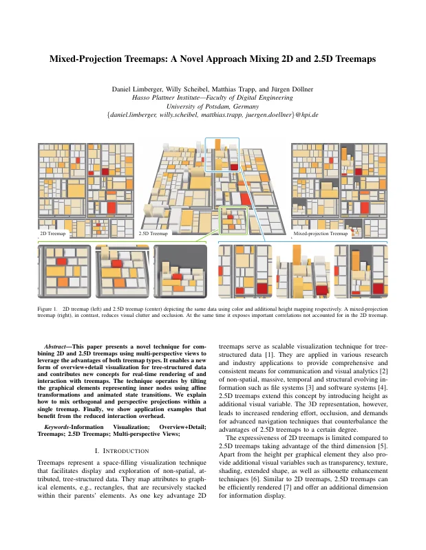
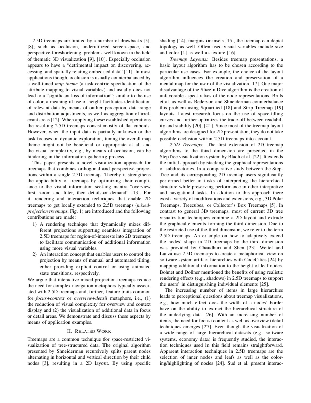
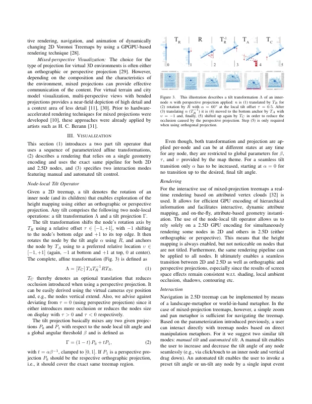
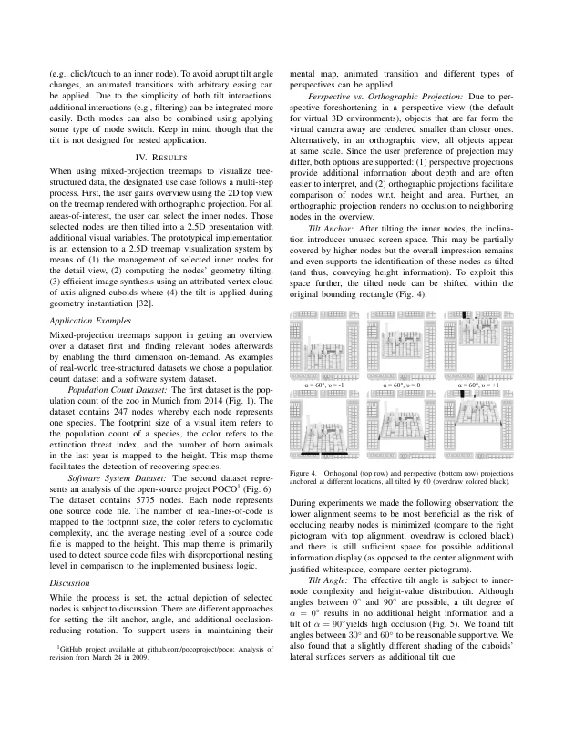
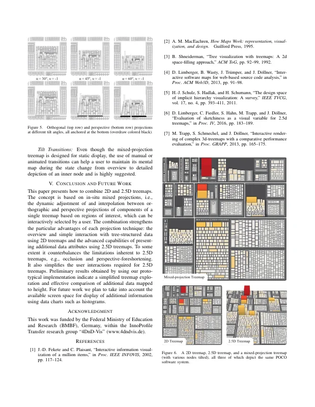
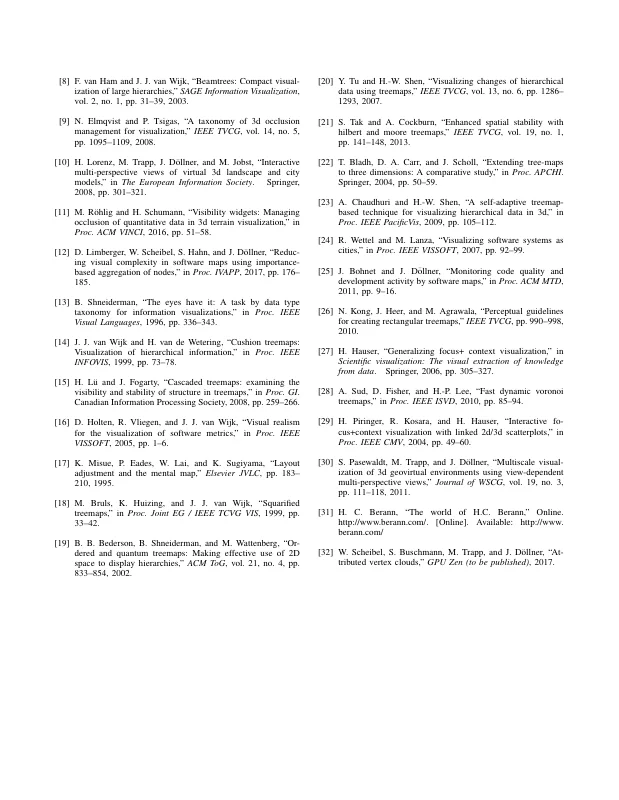

# Mixed-Projection Treemaps: A Novel Approach Mixing 2D and 2.5D Treemaps

[Daniel Limberger](https://orcid.org/0000-0002-9111-4809), [Willy Scheibel](https://orcid.org/0000-0002-7885-9857), [Matthias Trapp](https://orcid.org/0000-0003-3861-5759), and [Jürgen Döllner](https://orcid.org/0000-0002-8981-8583)

*21st International Conference Information Visualisation (IV '17)*, July 11–14, 2017, London, United Kingdom. IEEE, pp. 164–169.

[](https://doi.org/10.1109/iV.2017.67) [](https://www.researchgate.net/publication/316999964)

> This paper presents a novel technique for combining 2D and 2.5D treemaps using multi-perspective views to leverage the advantages of both treemap types.
> It enables a new form of overview+detail visualization for tree-structured data and contributes new concepts for real-time rendering of and interaction with treemaps.
> The technique operates by tilting the graphical elements representing inner nodes using affine transformations and animated state transitions.
> We explain how to mix orthogonal and perspective projections within a single treemap.
> Finally, we show application examples that benefit from the reduced interaction overhead.

<p><a href="limberger2017-mixed-as-submitted.pdf"></a> <a href="limberger2017-mixed-as-submitted.pdf"></a> <a href="limberger2017-mixed-as-submitted.pdf"></a> <a href="limberger2017-mixed-as-submitted.pdf"></a></p>
<details><summary>Remaining 2 pages</summary><p><a href="limberger2017-mixed-as-submitted.pdf"></a> <a href="limberger2017-mixed-as-submitted.pdf"></a></p></details>

## Contents

- [`src/`](src/) – LaTeX sources of the camera-ready version (IEEE conference template, `IEEEtran.cls` V1.7a, `compsocconf`)
- [`limberger2017-mixed-as-submitted.pdf`](limberger2017-mixed-as-submitted.pdf) – camera-ready PDF as submitted to IEEE (2017-05-27, certified by IEEE PDF eXpress)
- [`slides/`](slides/) – LaTeX sources of the talk (beamer)
- [`limberger2017-mixed-slides.pdf`](limberger2017-mixed-slides.pdf) – slides as presented at IV 2017 (without the two embedded screencast videos)
- [`build.sh`](build.sh) – reproducible build of paper and slides (podman or docker)
- [`preview/`](preview/) – page previews for this README

## Build

```bash
./build.sh          # → build/iv17-submission-cr.pdf
./build.sh slides   # → build-slides/iv-mixed.pdf
```

`IEEEtran.cls` (V1.7a) is bundled in `src/` and takes precedence over the TeX Live version.
`limberger2017-mixed-as-submitted.pdf` was built with MiKTeX (pdfTeX 1.40.16); the build with TeX Live 2015 (also pdfTeX 1.40.16) reproduces it pixel-identically.
The slides were built the same way; the build reproduces `limberger2017-mixed-slides.pdf` pixel-identically.

## Credits

The slides contain third-party images; the iceberg (`slides/images/iceberg.jpg`, slide "Software Maps | Goals") is from [Geo a Day](https://geoaday.tumblr.com/post/32336708639) by Jeremiah Shaw and Danny Jones (2012).

## Versions

- [`v1.0-camera-ready`](https://github.com/dl-archive/article.2017-iv-mixed-projection/tree/v1.0-camera-ready) – sources as submitted to IEEE, and the talk

## Citation

```bibtex
@InProceedings{limberger2017-mixed,
  author    = {Limberger, Daniel and Scheibel, Willy and Trapp, Matthias and D{\"o}llner, J{\"u}rgen},
  title     = {Mixed-Projection Treemaps: A Novel Approach Mixing 2D and 2.5D Treemaps},
  booktitle = {21st International Conference Information Visualisation},
  year      = {2017},
  series    = {IV~'17},
  publisher = {IEEE},
  pages     = {164--169},
  doi       = {10.1109/iV.2017.67},
  isbn      = {978-1-538608-31-9},
}
```
